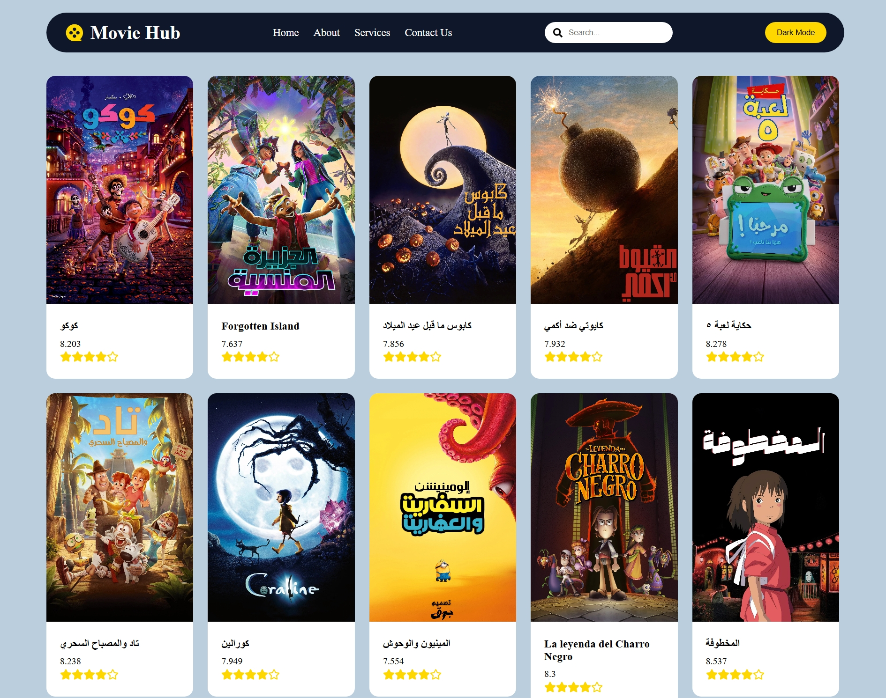

  

  

  
  
  
  

  

---

## About Me

Software Engineering student and front-end developer focused on building responsive, accessible, and maintainable user interfaces. I work with React on the web and React Native (Expo) on mobile, consume REST APIs, and turn Figma designs into production-ready screens. I'm now expanding into backend development with Node.js to become a well-rounded full-stack engineer.

**Currently focused on**

- Next.js and advanced JavaScript patterns
- Backend fundamentals with Node.js
- Clean code, component architecture, and API integration

---

## Tech Stack

  

<table align="center">
  <tr>
    <td><b>Languages</b></td>
    <td>JavaScript (ES6+), HTML5, CSS3</td>
  </tr>
  <tr>
    <td><b>Front-End</b></td>
    <td>React, Vite, Tailwind CSS, Bootstrap</td>
  </tr>
  <tr>
    <td><b>Mobile</b></td>
    <td>React Native, Expo</td>
  </tr>
  <tr>
    <td><b>Tools</b></td>
    <td>Git, GitHub, Postman, Figma, VS Code</td>
  </tr>
  <tr>
    <td><b>Learning</b></td>
    <td>Next.js, Node.js</td>
  </tr>
</table>

---

## Featured Projects

<table>
  <tr>
    <td width="50%" valign="top">
      
      <h3>Internship Platform</h3>
      
A platform that connects students with institutions to discover and apply for internship opportunities.

      

        
        
        
      

    </td>
    <td width="50%" valign="top">
      
      <h3>Movie Application</h3>
      
A movie browsing app that fetches and displays data from external APIs, with a clean and responsive UI.

      

        
        
        
      

    </td>
  </tr>
  <tr>
    <td width="50%" valign="top">
      
      <h3>Product Store</h3>
      
An e-commerce product app with product listing and global state management.

      

        
        
        
      

    </td>
    <td width="50%"></td>
  </tr>
</table>

---

## GitHub Stats

  

  
  

---

## Let's Work Together

  Have a project in mind or want to collaborate? Reach out on LinkedIn or through any of the freelance platforms above.

  

