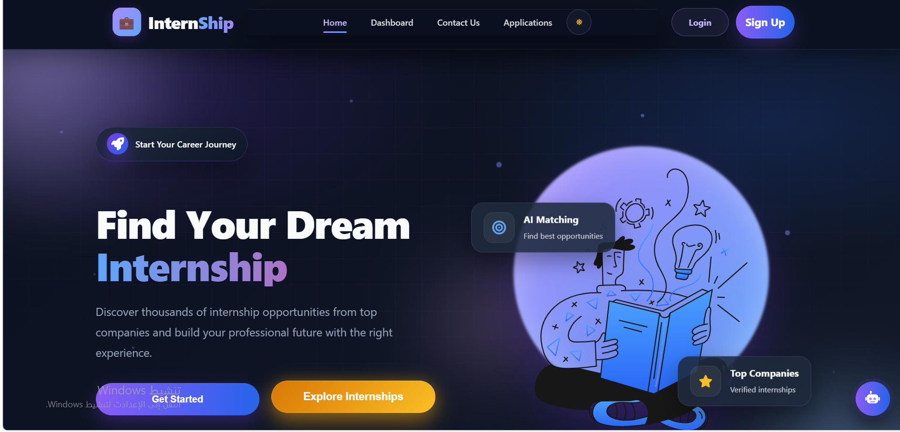
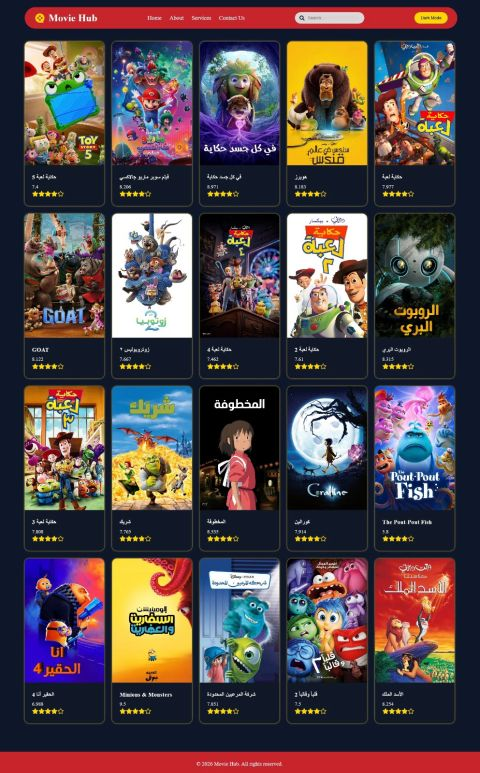
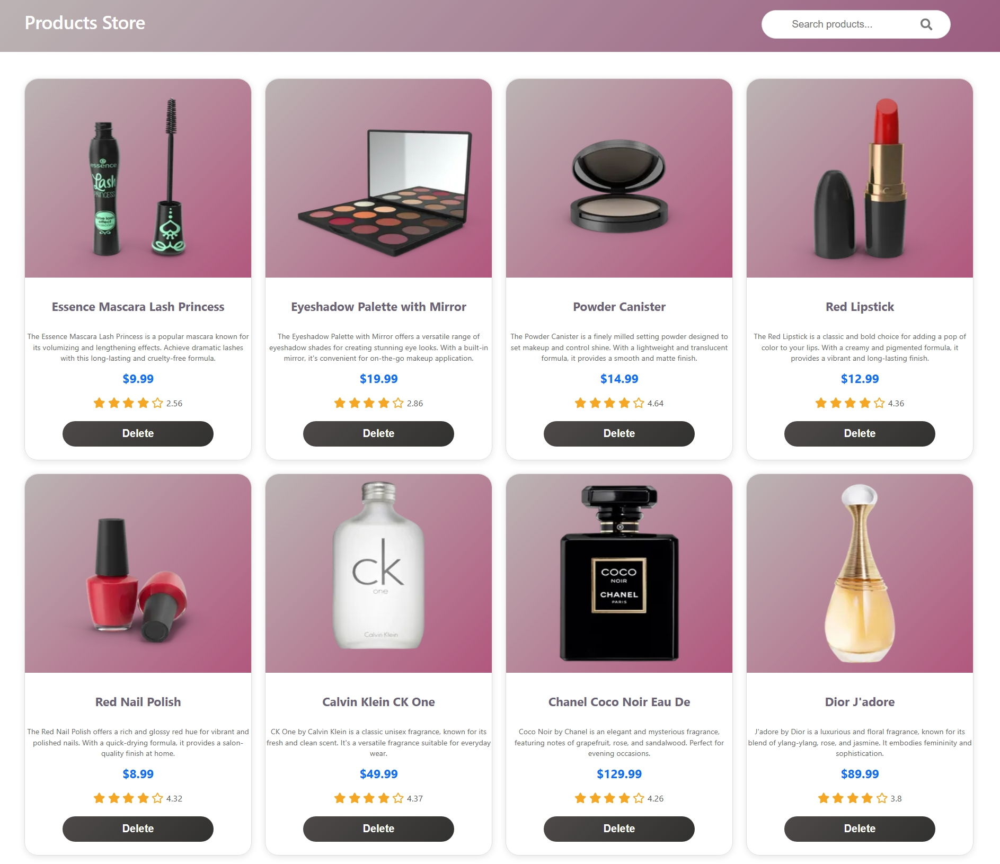

<h1 align="center">Besan Naser</h1>

  

  <b>Front-End Developer</b> · React &amp; React Native 
  Software Engineering Student · Transitioning into Full-Stack

  
  
  
  

---

## About

Software Engineering student and front-end developer focused on building responsive, accessible, and maintainable user interfaces. I work with React on the web and React Native (Expo) on mobile, consume REST APIs, and turn Figma designs into production-ready screens. I'm now expanding into backend development with Node.js to become a well-rounded full-stack engineer.

**Currently focused on**

- Next.js and advanced JavaScript patterns
- Backend fundamentals with Node.js
- Clean code, component architecture, and API integration

**Open to** freelance projects, internships, and collaboration.

---

## Tech Stack

  

| Area | Technologies |
|---|---|
| **Languages** | JavaScript (ES6+), HTML5, CSS3 |
| **Front-End** | React, Vite, Tailwind CSS, Bootstrap |
| **Mobile** | React Native, Expo |
| **Tools** | Git, GitHub, Postman, Figma, VS Code |
| **Learning** | Next.js, Node.js |

---

## Featured Projects

<table>
  <tr>
    <td width="50%" valign="top">
      
      <h3>Internship Platform</h3>
      
A platform that connects students with institutions to discover and apply for internship opportunities.

      
<b>Stack:</b> React, Vite, Axios, REST API

    </td>
    <td width="50%" valign="top">
      
      <h3>Movie Application</h3>
      
A movie browsing app that fetches and displays data from external APIs, with a clean and responsive UI.

      
<b>Stack:</b> React, JavaScript, API Integration

    </td>
  </tr>
  <tr>
    <td width="50%" valign="top">
      
      <h3>Product Store</h3>
      
An e-commerce product app with product listing and global state management.

      
<b>Stack:</b> React, Context API, REST API

    </td>
    <td width="50%"></td>
  </tr>
</table>

---

## GitHub Stats

  
  

  

